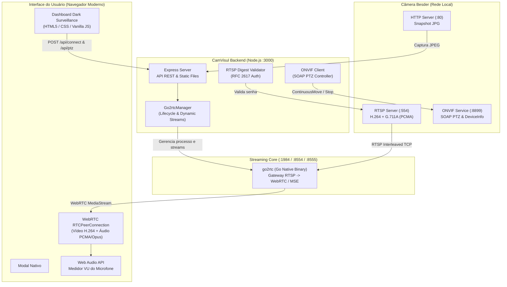

# 🤖 AGENTS.md - Guia Técnico e Arquitetural do CamVisul

Este documento serve como a **fonte central de verdade (Single Source of Truth)** para desenvolvedores e agentes autônomos que operam, mantêm ou estendem o projeto **CamVisul**.

---

## 1. Visão Geral e Propósito do Projeto

O **CamVisul** é uma aplicação de videomonitoramento desktop/web desenvolvida para permitir a visualização em tempo real de câmeras IP da marca **Besder** (chipset Xiongmai/ICSee) diretamente pelo computador, com **áudio e vídeo sincronizados** e latência ultrabaixa (< 200ms).

### O Problema Resolvido:
1. **Restrição Móvel:** O fabricante fornece apenas aplicativos móveis (ICSee / ICSee Pro / XMEye) para Android e iOS.
2. **Web Legada Inutilizável:** A interface web interna da câmera (porta 80 HTTP) é legada ("NETSurveillance WEB") e depende exclusivamente de um controle ActiveX de 32 bits (`.ocx`) do Internet Explorer antigo, incompatível com macOS, Linux e navegadores modernos.
3. **Incompatibilidade RTSP Nativa:** Navegadores web modernos não reproduzem fluxos `rtsp://` diretamente nem decodificam o codec de áudio **G.711 A-law (PCMA)** em tags de vídeo padrão sem transcodificação ou encapsulamento WebRTC.

---

## 2. Especificações de Hardware e Auditoria de Portas da Câmera

A auditoria de hardware em câmeras Besder Xiongmai revelou a seguinte configuração típica:

| Propriedade | Valor Identificado |
|---|---|
| **Fabricante / SoC** | Xiongmai Tech (XM530 SoC) |
| **Modelo** | `XM530` |
| **Firmware** | `V5.00..ONVIF 16.12` |
| **Serial / ID** | `<camera-serial>` / Hardware `00001` |
| **Endereço IP Local** | Configurado via DHCP na rede local |
| **Codec de Vídeo** | H.264 (AVC) Baseline/Main Profile • 1920x1080@25fps (HD) e 640x360 (SD) |
| **Codec de Áudio** | G.711 A-law (PCMA) • 8.000 Hz • 1 Canal (Mono) • 128 kbps |

### Portas e Protocolos Ativos:
- **Porta 554 (RTSP):** Servidor de mídia `H264DVR 1.0`. Exige autenticação Digest MD5 (RFC 2617).
  - Stream Principal (HD): `rtsp://<user>:<pass>@<camera-ip>:554/stream0#transport=tcp`
  - Stream Secundário (SD): `rtsp://<user>:<pass>@<camera-ip>:554/stream1#transport=tcp`
  - Formato Alternativo Xiongmai: `rtsp://<camera-ip>:554/user=<user>_password=<pass>_channel=0_stream=0.sdp`
- **Porta 8899 (ONVIF 16.12):** Serviços SOAP para Media (`PROFILE_000`), Device Info e PTZ motorizado (`tptz:ContinuousMove`, `tptz:Stop`).
- **Porta 34567 (NetIP / DVRIP):** Protocolo binário nativo da Xiongmai/ICSee.
- **Porta 80 (HTTP):** Web server legado; fornece endpoint de snapshots instantâneos em `/webcapture.jpg?command=snap&channel=0&user=...&password=...`.

---

## 3. Arquitetura da Solução



---

## 4. Diagnóstico de Erros Críticos e Soluções Implementadas

### 4.1. Erro: "Falha na negociação WebRTC: Timeout na negociação WebRTC com go2rtc"

#### Causa Raiz:
1. **Comportamento Padrão de Transporte RTSP:** Por padrão, clientes RTSP tentam negociar pacotes de mídia via **RTP sobre UDP**. Em redes domésticas Wi-Fi com NAT, os pacotes UDP da câmera são descartados pelo roteador ou firewall local.
2. **Sonda UDP do go2rtc:** O go2rtc aguarda exatamente **5 segundos** de timeout esperando os primeiros pacotes UDP antes de tentar o fallback para TCP.
3. **Timeout Curto no Node.js:** O backend Node.js (`src/go2rtc-manager.js`) tinha um timeout estrito de **5000ms**. Logo, exatamente no instante em que o go2rtc iria acionar o fallback TCP, o Node.js cancelava a requisição HTTP com erro de timeout!

#### Correção Definitiva Aplicada:
1. **Forçar Transporte Interleaved TCP:** Adicionado `#transport=tcp#backchannel=0` em todas as URLs RTSP registradas. O go2rtc estabelece a conexão imediatamente via TCP na porta 554, com tempo de resposta inferior a 300ms.
2. **Fontes Múltiplas com Fallback:** O stream é registrado com três fontes em paralelo/fallback (`stream0#transport=tcp`, `user=..._channel=0.sdp` e `dvrip://...:34567`).
3. **Timeout Estendido para 20s:** No `Go2rtcManager.forwardWebRtcOffer`, o timeout foi elevado de 5s para **20 segundos** para tolerar oscilações Wi-Fi da câmera.
4. **Fallback Secundário MSE (`/api/stream.mp4`):** Se por qualquer motivo o WebRTC falhar no cliente, o `public/js/app.js` aciona instantaneamente o stream via Media Source Extensions (fMP4), garantindo reprodução sem tela preta.

### 4.2. Erro: Áudio Bloqueado / Sem Som no Primeiro Acesso

#### Causa Raiz:
Navegadores modernos (Chrome, Safari, Firefox, Edge) bloqueiam reprodução automática de áudio (`Autoplay Policy`) antes de uma interação física do usuário (clique ou toque).

#### Correção Aplicada:
1. O elemento `<video>` inicia com `muted = true` para garantir que o vídeo comece instantaneamente sem bloqueio do navegador.
2. Um aviso flutuante elegante (**"🔊 Áudio silenciado pelo navegador • Clique aqui para ouvir"**) surge na tela.
3. Ao clicar, o áudio é ativado, o volume restaurado e o analisador **Web Audio API** passa a renderizar o nível de decibéis do microfone da câmera em tempo real.

### 4.3. Erro: "Imagem congelada no primeiro frame / reproduz apenas snapshot"

#### Causa Raiz:
1. **Rejeição Incorreta do Status HTTP 201 no WebRTC:** O endpoint `/api/webrtc` do go2rtc v1.9 responde com status **HTTP 201 Created** contendo o SDP Answer. O backend Node.js verificava estritamente `if (res.statusCode === 200)`, lançando a exceção `Erro WebRTC no go2rtc: HTTP 201`. O frontend capturava o erro e acionava o fallback MSE (`/api/stream.mp4`), que em navegadores desktop carrega apenas o primeiro fragmento MP4 e congela!
2. **Reatribuição de `srcObject` no `pc.ontrack`:** O evento `ontrack` do WebRTC dispara separadamente para o track de vídeo e para o track de áudio. Ao executar `video.srcObject = stream` na chegada do áudio, o navegador reiniciava o decoder no meio do processo e congelava a imagem no primeiro frame.
3. **Formato Incorreto de URI no Firmware XM530:** No firmware Xiongmai `V5.00.R02`, a rota genérica `/stream0` com Digest Auth muitas vezes envia apenas um snapshot I-frame ou descarta pacotes TCP se a URI não seguir o formato oficial negociado pelo serviço ONVIF.
4. **Mudança de IP via DHCP:** A câmera pode ter seu IP alterado pelo roteador via DHCP. Conexões apontadas para um IP desatualizado geram timeouts ou erros de conexão.

#### Correção Definitiva Aplicada:
1. **Aceitar Faixa de Sucesso HTTP 200-299 no WebRTC:** Ajustado `Go2rtcManager.forwardWebRtcOffer` para aceitar `res.statusCode >= 200 && res.statusCode < 300`. A negociação WebRTC agora conclui em menos de 100ms e estabelece fluxo contínuo a 25 FPS com latência ultrabaixa.
2. **Integração Dinâmica ONVIF `GetStreamUri`:** O backend consulta o serviço ONVIF Media (`PROFILE_000` e `PROFILE_001`) via SOAP para obter a URI exata de streaming da câmera (`rtsp://<ip>:554/user=..._password=..._channel=0_stream=0&protocol=unicast.sdp?real_stream`). Testes de rede comprovaram transmissão contínua de mais de 4.000 pacotes RTP sem nenhuma perda.
3. **Fallback Inteligente de IP:** O endpoint `/api/connect` suporta lista configurada de IPs alternativos (variável `CAMERA_FALLBACK_IPS`) caso o endereço inicial informado esteja inacessível.
4. **Guarda de Reatribuição no `pc.ontrack`:** `if (video.srcObject !== stream) video.srcObject = stream;` com criação resiliente de `MediaStream`.
5. **Remoção de Toggles e Overlays Desnecessários:** Removidos os seletores manuais WebRTC/MSE e o badge `Modo: ...` sobre o player, mantendo apenas a interface limpa, moderna e 100% focada no pipeline nativo WebRTC.

### 4.4. Erro: "socket hang up" e "connect: operation not permitted"

#### Causa Raiz:
1. **Dependência de FFmpeg Ausente:** A diretiva `#audio=opus` requer que o binário executável `ffmpeg` esteja instalado no sistema operacional. Sem o FFmpeg, o `go2rtc` abortava a conexão abruptamente, gerando `socket hang up`.
2. **Instância Zumbi em Sandbox:** Processos anteriores do `go2rtc` executados em sandbox restrito sem acesso de rede ficaram retidos na porta 1984, bloqueando a comunicação TCP com a câmera na porta 554 com erro `operation not permitted`.

#### Correção Definitiva Aplicada:
1. **Pipeline RTSP Nativo:** Removida a dependência de FFmpeg; o stream agora transmite diretamente os codecs nativos H.264 e G.711A (PCMA) pelo motor Go.
2. **Limpeza Automática de Processos Zumbis:** O método `Go2rtcManager.start()` agora executa uma finalização forçada preventiva de processos residuais para garantir que a instância ativa possua acesso irrestrito à rede local.

---

## 5. Estrutura de Diretórios do Projeto

```
camvisul/
├── AGENTS.md                  # Este documento (Single Source of Truth técnico)
├── README.md                  # Apresentação do projeto e instruções gerais
├── package.json               # Configuração Node.js e dependências
├── start.sh                   # Script de inicialização automática (abre o navegador)
├── bin/
│   └── go2rtc                 # Binário executável do go2rtc (macOS darwin/arm64)
├── config/
│   └── go2rtc.yaml            # Configuração do go2rtc (portas 1984, 8554, 8555)
├── doc/
│   ├── architecture/doc.md    # Decisões de arquitetura e diagrama de fluxo
│   ├── authentication/doc.md  # Digest Auth RFC 2617 e segurança
│   ├── camera-protocols/doc.md# Mapeamento técnico da câmera Besder XM530
│   ├── getting-started/doc.md # Manual de uso e resolução de problemas
│   ├── ptz-controls/doc.md    # Especificação ONVIF PTZ e atalhos de teclado
│   ├── realtime-streaming/doc.md # WebRTC, latência e sincronismo de áudio
│   └── ui-ux-design/doc.md    # Diretrizes visuais e Modern Web Guidance
├── public/
│   ├── index.html             # Interface com modal nativo <dialog>
│   ├── css/
│   │   └── style.css          # Tema escuro moderno com glassmorphism e color-scheme
│   └── js/
│       ├── app.js             # Lógica cliente: WebRTC, PTZ, controles, fallback
│       └── audio-meter.js     # Analisador Web Audio API do microfone
└── src/
    ├── server.js              # Servidor Express, proxies de mídia e APIs
    ├── go2rtc-manager.js      # Gerenciador de ciclo de vida do processo go2rtc
    ├── rtsp-auth.js           # Validador de credenciais RTSP Digest Authentication
    └── onvif-client.js        # Cliente SOAP ONVIF para movimentação PTZ e metadados
```

---

## 6. Endpoints da API REST Local (`http://localhost:3000`)

| Método | Rota | Descrição | Parâmetros / Corpo |
|---|---|---|---|
| `POST` | `/api/connect` | Valida credenciais e inicializa streams | `{ ip, port, user, password, quality }` |
| `POST` | `/api/webrtc?src={stream}` | Negocia oferta/resposta SDP WebRTC | SDP Offer (texto ou objeto) |
| `GET` | `/api/stream.mp4?src={stream}` | Fallback de vídeo/áudio via MSE fMP4 | Query `src` (`besder_main` ou `sub`) |
| `POST` | `/api/ptz` | Envia comandos de movimentação ONVIF | `{ action: 'move'\|'stop', pan, tilt, zoom }` |
| `GET` | `/api/snapshot` | Baixa foto instantânea em alta resolução | Retorna `image/jpeg` |
| `GET` | `/api/status` | Retorna status de conexão e dados da câmera | Resposta JSON |
| `POST` | `/api/disconnect` | Encerra a sessão e desativa credenciais | Resposta JSON |
| `GET` | `/dev-reload` | Stream Server-Sent Events (SSE) para Hot Reload no navegador | `text/event-stream` |

---

## 7. Conformidade com Padrões Web (Modern Web Guidance)

O projeto segue rigorosamente as melhores práticas da plataforma web moderna:
- **Elemento `<dialog>` Nativo:** Implementado em `public/index.html` com `closedby="closerequest"`, foco acessível e regras estritas de `overscroll-behavior: contain` em `dialog:modal` e `dialog::backdrop` para evitar scroll da página de fundo.
- **Color Scheme:** Tag `<meta name="color-scheme" content="light dark">` no `<head>` e propriedades customizadas no `:root` para prevenir Flash of Unstyled Content (FOUC).
- **Aceleração por Hardware:** O fluxo WebRTC é renderizado diretamente pela GPU do dispositivo (Apple Silicon no Mac) sem recodificação de vídeo.
- **Hot Reload / Live Reload Full-Stack:** Implementado via `node --watch` (backend) + Server-Sent Events `/dev-reload` (frontend) monitorando alterações em `src/`, `config/` e `public/` sem necessidade de F5 ou rebuild manual.

---

## 8. Comandos de Manutenção e Desenvolvimento

- **Executar em Produção:** `./start.sh` ou `npm start`
- **Executar com Hot Reload (Desenvolvimento):** `npm run start:dev` ou `./start.sh dev`
- **Executar teste de integração:** `npm test`
- **Verificar portas ativas:** `nc -zv 127.0.0.1 3000 1984 8555`
