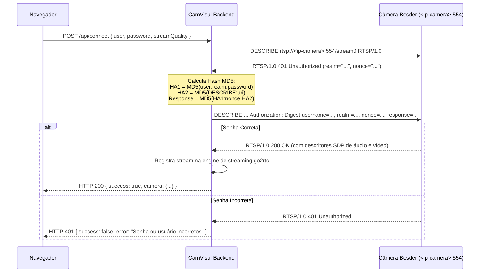

# Autenticação e Segurança Local

## 1. Contexto e Requisitos do Usuário

O usuário especificou:
> *"Nesta versão vamos usar apenas a conexão local com o IP da câmera (para acessar deve solicitar login e senha)"*

Para atender a este requisito com segurança, praticidade e robustez:
1. Ao abrir a aplicação pela primeira vez ou quando não houver sessão ativa, um **modal de login moderno e limpo** é apresentado.
2. O usuário informa o login (padrão `admin`) e a senha criada por ele no aplicativo ICSee.
3. O backend realiza um handshake de pré-validação contra o servidor RTSP da câmera antes de autorizar a conexão.
4. Caso as credenciais estejam erradas, uma mensagem clara em português é exibida ao usuário sem travar a interface.

---

## 2. O Mecanismo RTSP Digest Authentication (RFC 2617 / RFC 2326)

A câmera Besder protege seu fluxo RTSP com autenticação baseada em Digest MD5.

### Fluxo de Validação:

---

## 3. Armazenamento e Lembrança de Credenciais

Para comodidade do usuário doméstico:
- O modal disponibiliza a opção **"Lembrar credenciais neste computador"**.
- Se marcada, as credenciais são salvas no `localStorage` do navegador da máquina local do usuário.
- Se desmarcada, as credenciais ficam apenas na memória volátil da sessão (`sessionStorage`), sendo descartadas ao fechar a janela.
- Há também um botão visível **"Desconectar / Trocar Senha"** no menu superior do dashboard, permitindo limpar qualquer credencial salva com um clique.

---

## 4. Isolamento de Rede

- Toda a comunicação é estritamente local (`127.0.0.1` e rede local privada).
- Nenhuma porta externa é aberta via UPnP ou encaminhamento de porta (port forwarding).
- Nenhuma telemetria externa ou servidor de terceiros é utilizado.
