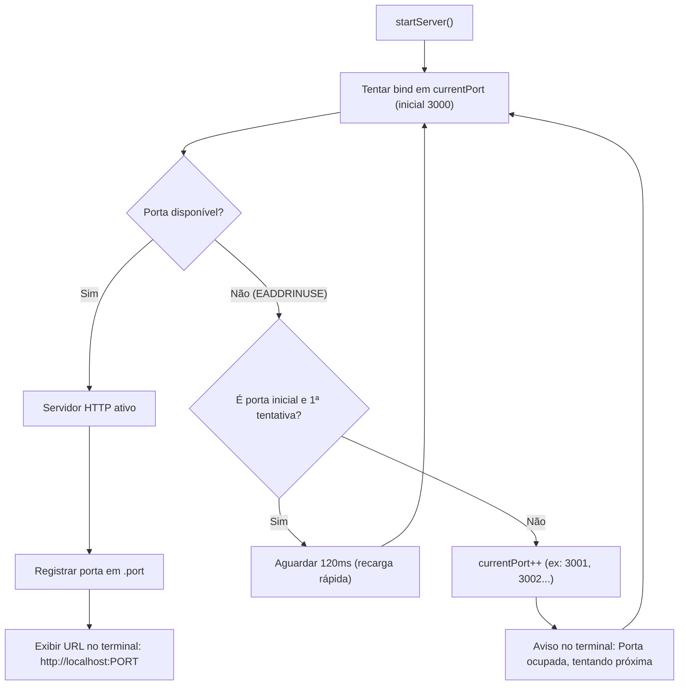

# 🔌 Dynamic Ports & Automatic Fallback (Resolução Dinâmica de Portas)

Este documento descreve a arquitetura, motivação e funcionamento da alocação dinâmica de portas com fallback sequencial no **CamVisul**.

---

## 1. Contexto e Motivação

Durante o ciclo de desenvolvimento (`npm run start:dev` / `node --watch-path=./src`) ou em ambientes onde múltiplos serviços estão ativos simultaneamente, a porta padrão **3000** pode estar ocupada por:
- Outra instância do CamVisul em execução;
- Outros servidores de desenvolvimento locais (React, Vite, Next.js, Rails, etc.);
- Sockets em processo de liberação pelo sistema operacional.

Se o servidor simplesmente falhar com `EADDRINUSE`, o desenvolvedor ou usuário é forçado a matar processos manualmente ou passar flags manuais de porta.

---

## 2. Decisão Arquitetural: Fallback Sequencial Automático

Implementamos um mecanismo transparente de inicialização assíncrona com `listenWithPortFallback`:

1. **Porta Inicial:** O servidor inicia a tentativa pela porta configurada em `process.env.PORT` ou **3000** por padrão.
2. **Detecção Atômica de `EADDRINUSE`:** Se a porta estiver em uso, o evento de erro é capturado e limpo imediatamente sem deixar sockets pendentes.
3. **Tolerância a Recarga Rápida (Hot Reload):** Se o erro ocorrer na porta inicial, o sistema aguarda 120ms para verificar se o socket estava apenas sendo liberado pelo watcher do Node (`--watch`), evitando trocas desnecessárias de porta.
4. **Incremento Sequencial (`port++`):** Caso a porta permaneça ocupada, o servidor tenta automaticamente a porta subsequente (`3001`, `3002`, `3003`...) até encontrar uma porta disponível (limite de 50 tentativas).
5. **Comunicação Interprocessos via `.port`:** A porta final selecionada é salva no arquivo `.port` (ignorado no git) para que scripts como `start.sh` abram o navegador exatamente no endereço correto.
6. **Limpeza Graciosa:** No encerramento (`SIGINT` ou `SIGTERM`), o arquivo `.port` é removido e todas as conexões ativas são finalizadas.

---

## 3. Fluxo de Execução

---

## 4. Integração com Frontend e Scripts

- **Frontend Agnostico:** Todas as requisições do frontend (`public/js/app.js`) utilizam URLs relativas (`/api/connect`, `/api/webrtc`, `/dev-reload`), funcionando perfeitamente em qualquer porta (3000, 3001, 3002...).
- **`start.sh` Inteligente:** Monitora a criação do arquivo `.port` e aciona o comando `open http://localhost:<PORT>` com a porta real utilizada.
- **Testes Automatizados:** Suíte em `test/port-fallback.test.js` cobre a detecção de colisões individuais e múltiplas portas bloqueadas em sequência.
